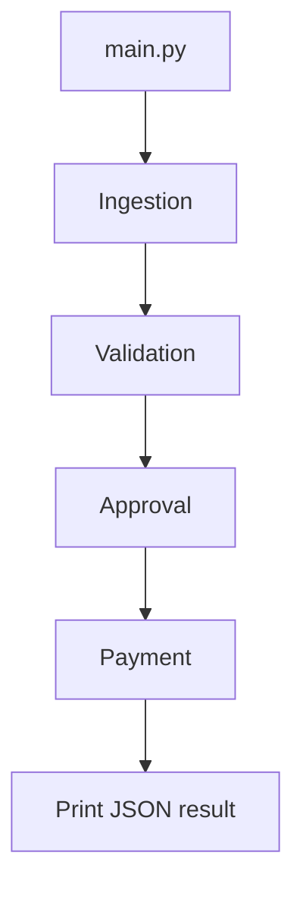

# Invoice Processing Build Plan

> For agentic workers: after this plan is accepted, build one step at a time. Write the test, watch it fail, write the smallest code that passes, then commit before the next step.

**Goal:** A local command, `python main.py --invoice_path=<file>`, that runs Ingestion, Validation, Approval, and Payment on the sample invoices and prints an audit-ready result.

**Architecture:** Pydantic models carry the invoice between four small agents. Plain Python decides every money, stock, and date outcome. The LLM only extracts messy text, normalizes it, writes a short approval summary, and flags a suspicious address. LangGraph connects the four agents in a straight line. The default LLM is a fake one, so the project runs with no API key.

**Tech stack:** Python 3.11, Pydantic v2, LangGraph, SQLite, pdfplumber, pytest, and the `xai-sdk` package with the model pinned to `grok-4.7`.

## Global constraints

These come from [TASK.md](TASK.md), [DECISIONS.md](DECISIONS.md), and [.cursor/rules/project.mdc](.cursor/rules/project.mdc). Every step follows them.

- Python 3.11 or newer. Entry point: `python main.py --invoice_path=<file>`.
- Pipeline order: Ingestion, then Validation, then Approval, then Payment.
- Follow the 12 rows in DECISIONS.md. Do not add business rules, a UI, a real bank call, or a live exchange rate.
- Use `Decimal` for every money amount. Store catalog prices as text and convert them with `Decimal`. Never use `float` for money.
- Pass invoice data between agents as Pydantic models.
- Grok is called only through `xai-sdk`, model `grok-4.7`. Read the key from `XAI_API_KEY`. Never put the key in a file.
- The default run uses the mock LLM. `--use-llm` is what calls Grok.
- Inventory is a local SQLite file created by a setup script.
- Payment is a mock function. It never calls a network.
- Every outcome is logged with a reason a person can read.
- Each agent has pytest tests, and each test asserts a real result so it can fail.
- One agent per file. No features beyond TASK.md and DECISIONS.md.

## How two rules on one invoice are resolved

Several sample invoices match more than one row. The agents collect every finding. The final status is the strongest finding:

- A **reject** finding makes the status `rejected`.
- A **hold** finding makes the status `hold` when nothing was rejected.
- Otherwise the status is `approved`, and Payment may pay it.
- `late` is a mark on the result. It does not change the status.
- `--auto-approve` changes only the over-$10,000 human gate in row 12. It does not override a reject or any other hold.

So INV-1007 and INV-1013 are rejected for the bad total. Their stock and dollar-amount findings are still written in the log. INV-1002 is a hold for low stock and for being over $10,000. INV-1004's revised copy is the invoice that goes through the checks, the original is voided in the log, and the famous address still makes the result a hold.

## 1. Folder and file structure

```
main.py                          # reads the CLI flags and starts the graph
setup_inventory.py               # creates and seeds the SQLite file
requirements.txt
.gitignore                       # ignores data/inventory.db, logs/, .venv/, __pycache__/
invoice_agents/
  __init__.py
  models.py                      # Invoice, LineItem, Finding, PipelineState
  inventory.py                   # open the db and look up one item
  audit.py                       # append one JSON line per decision
  normalize.py                   # invoice numbers, item names, O-for-zero, dates
  parsers.py                     # JSON, CSV, and XML to a dict
  llm.py                         # MockLlm and GrokLlm behind one interface
  graph.py                       # the LangGraph line of four nodes
  agents/
    ingestion.py
    validation.py
    approval.py
    payment.py
tests/
  conftest.py                    # a temp database and a helper that builds an Invoice
  test_models.py
  test_inventory.py
  test_normalize.py
  test_validation.py
  test_llm.py
  test_ingestion.py
  test_approval.py
  test_payment.py
  test_graph.py
data/invoices/                   # already here; do not edit these files
data/inventory.db                # created by the setup script, not committed
logs/audit.jsonl                 # created at runtime, not committed
```

`data/generate_pdfs.py` already exists and stays as it is.

## 2. Pydantic models

All of these live in [invoice_agents/models.py](invoice_agents/models.py). Money fields are `Decimal`. Dates are `datetime.date`. Extra fields are forbidden so a typo fails loudly.

**LineItem**

- `item`: string. Catalog spelling after normalization, such as `WidgetA`. The shipping line keeps the name `Shipping`.
- `quantity`: int.
- `unit_price`: Decimal.
- `amount`: Decimal or empty. When the file has no line amount, set it to `quantity * unit_price`.
- `note`: string or empty. INV-1013 uses notes such as `Volume discount`.

**Invoice**

- `invoice_number`: string, always `INV-` plus the digits. `1002` and `INV 1012` both become `INV-1002` and `INV-1012`.
- `revision`: string or empty. The revised file sets this to `R1`.
- `vendor_name`: string. An empty name is allowed; INV-1009 has one, and the reject reason is the negative quantity.
- `vendor_address`: string or empty.
- `invoice_date` and `due_date`: dates or empty.
- `currency`: string, default `USD`. Missing currency on a file means USD.
- `line_items`: list of LineItem.
- `subtotal`: Decimal or empty.
- `tax_amount`: Decimal, default `0`.
- `total`: Decimal. This is the total printed on the invoice, even when it is wrong.
- `payment_terms`, `notes`: strings or empty.
- `source_files`: list of paths that were grouped into this invoice.
- `corrections`: list of strings, one per normalization change.
- `address_warnings`: list of strings returned by the LLM.

**Finding**

- `rule`: int, the row number 1 through 12.
- `outcome`: `reject`, `hold`, or `info`.
- `reason`: one sentence that includes the numbers a reviewer needs. A money difference is a `Decimal` printed with two decimal places, such as `-110.00` or `50.00`.

**PipelineState**

- `source_path`, `db_path`, `audit_path`: strings.
- `invoice`: Invoice or empty.
- `findings`: list of Finding.
- `status`: `pending`, `rejected`, `hold`, `approved`, or `voided`. Starts as `pending`.
- `late`: bool, default false.
- `summary` and `critique`: strings filled by Approval.
- `as_of`: date or empty. Empty means "use this invoice's own date".
- `auto_approve`: bool.
- `use_llm`: bool.
- `void_original`: bool. True when the file being processed is a revision.
- `payment_result`: dict or empty.

A helper on the state, `apply_findings()`, sets `status` from the list: any `reject` wins, else any `hold`, else `approved`. Agents call it after they append findings. They do not invent a second status ladder.

## 3. SQLite inventory

[setup_inventory.py](setup_inventory.py) creates the database. The default path is `data/inventory.db`. Tests call the same function with a temporary path.

The table is:

- `item` text, primary key
- `stock` integer, not null
- `unit_price` text, not null, so cents stay exact

Running the script drops and recreates the table, then inserts exactly these four rows. Prices are the repeated USD catalog prices from the sample invoices. The 10% rule in row 9 needs them, and the starter schema in TASK.md does not have a price column.

- `WidgetA`, stock 15, price `250.00`
- `WidgetB`, stock 10, price `500.00`
- `GadgetX`, stock 5, price `750.00`
- `FakeItem`, stock 0, price `1000.00`

[invoice_agents/inventory.py](invoice_agents/inventory.py) exposes `get_item(db_path, item_name)`. It returns the stock as an int and the price as a `Decimal`, or `None` when the item is absent. Item lookup for stock and price is case-sensitive on the catalog spelling. Normalization happens before this lookup.

Shipping is not a row. Validation recognizes a line named `Shipping` and does not look it up.

## 4. What each agent does

The shared state goes in and the same state comes out. Each agent appends findings and writes audit lines. None of them reads the clock. The only date used for "is this late?" is `--as-of`, or the invoice date when that flag is absent.



### Ingestion

File: [invoice_agents/agents/ingestion.py](invoice_agents/agents/ingestion.py).

Input: `source_path`, `use_llm`, and the database path. Output: one `Invoice` on the state, plus `void_original` when a revised copy wins. Status stays `pending` unless the copies disagree, in which case it adds a row 8 hold.

What it does:

1. Read the given file. JSON, CSV, and XML are parsed by code in [invoice_agents/parsers.py](invoice_agents/parsers.py). TXT is sent to the LLM interface. PDF is turned into text with pdfplumber and then sent to the same interface.
2. Normalize the draft with [invoice_agents/normalize.py](invoice_agents/normalize.py) and append a correction for every change.
3. Ask the LLM to flag the vendor address. Store whatever warnings it returns. Do not decide hold or reject here.
4. Scan the other files in the same directory and parse them far enough to know their invoice number.
5. Apply row 2 or row 8, described below.

Formats the parsers must accept:

- JSON objects like INV-1004, INV-1005, INV-1009, INV-1013, and INV-1016, including a nested vendor and a `revision` field.
- CSV pairs like INV-1006, where `item`, `quantity`, and `unit_price` repeat for each line.
- CSV tables like INV-1007 and INV-1015, where each item is a row and the last rows are `Subtotal:`, `Tax (6%):`, and `Total:`.
- XML like INV-1014, with the currency in the header.
- Messy text like INV-1001, INV-1002 (`Vndr`, `Inv #`, `Dt`), INV-1003 (`Due Date: yesterday`), INV-1008 (an email body), INV-1010 (a shipping line and a rush price), INV-1011, and INV-1012.

`yesterday` on INV-1003 becomes the day before that invoice's date, 2026-01-19.

Rows it handles:

- **Row 7, INV-1012.** Normalization fixes and logs `INV 1012` to `INV-1012`, `26-Jan-2O26` to 2026-01-26, `3,500.O0` to `3500.00`, `Widget A` to `WidgetA`, and `Gadget X` to `GadgetX`. The misspelled vendor name `QuickShip Distributers` is kept. After normalization the lines are WidgetA 12 at 250.00, WidgetB 7 at 500.00, and GadgetX 4 at 750.00, tax 475.00, total 9975.00.
- **Row 8, INV-1011 and INV-1013.** Files with the same invoice number and no revision marker are one invoice. Matching copies fill `source_files` and are processed once. INV-1012's txt and pdf pair follow this same rule. If a field differs, add a hold finding that names the field. This also covers a made-up pair in the test, because the real 1011 and 1013 copies agree.
- **Row 2, the selection half.** INV-1004 and `invoice_1004_revised.json` share `INV-1004`. The file with revision `R1`, a `_revised` filename, or a note that says it is revised is the one that continues. Set `void_original`. Do not merge it with the original and do not pay both. The void log line itself is written by Payment so there is one audit trail.

If the first extraction fails Pydantic validation, call the LLM once more with the error text. This is the self-correction loop. A second failure sets `rejected` with the parse error and stops the money path.

### Validation

File: [invoice_agents/agents/validation.py](invoice_agents/agents/validation.py).

Input: the Invoice and the database. Output: findings and an updated status. It never calls the LLM and never pays.

Checks, in this order:

1. **Row 6.** Every quantity must be a positive integer. When `subtotal` is present, it must equal the sum of the non-shipping line amounts. When a line states an amount, it must equal `quantity * unit_price`. INV-1009 fails: WidgetA quantity is -5, and the stated subtotal `1000.00` does not equal the line sum `-250.00`.
2. **Row 4.** `total` must equal the sum of every line amount, including shipping, plus `tax_amount`. On failure, reject and put the exact difference in the reason: stated minus expected. INV-1007 is `15525.00 - 15635.00 = -110.00`. INV-1013 is `22562.80 - 22512.80 = 50.00`. The line sums are 14750.00 and 21040.00, and the stated taxes 885.00 and 1472.80 are already correct.
3. **Row 3.** A currency other than USD is a hold. INV-1014 is EUR, total 4125.00. Skip the catalog price comparison for non-USD invoices. The $10,000 rule is also skipped here because that threshold is in dollars; Approval handles dollars only.
4. **Row 5.** Every non-shipping item must be in the database with stock greater than zero. INV-1008 (`SuperGizmo`, `MegaSprocket`) and INV-1016 (`WidgetC`) are unknown. INV-1003 (`FakeItem`, stock 0) is zero-stock. All three are rejected as suspicious, and the reason names the item. A zero-stock item does not also get a row 1 finding.
5. **Row 1.** Sum the quantities of each catalog item across lines. If the sum is greater than stock, and stock is above zero, hold. Equal to stock is fine: INV-1005 asks for 10 WidgetB and the stock is 10. Examples: INV-1002 asks for 20 GadgetX and stock is 5. INV-1005 asks for 8 GadgetX and stock is 5. INV-1013 sums to WidgetA 22, WidgetB 18, and GadgetX 9.
6. **Row 9.** `Shipping` is allowed and is not a stock check. For each other line, hold when `unit_price` is strictly greater than catalog price times `Decimal("1.10")`. INV-1010's rush WidgetA is `300.00` against a `250.00` catalog price, which is 20% over, so it holds. The other INV-1010 lines match the catalog. A price of exactly `275.00` passes. Discounts pass: INV-1013's `240.00` and `480.00` are below the catalog. INV-1010's total `7185.00` equals products `6700.00` plus shipping `150.00` plus tax `335.00`, so row 4 does not fire.

Then call `apply_findings()`.

### Approval

File: [invoice_agents/agents/approval.py](invoice_agents/agents/approval.py).

Input: the state, including address warnings, `as_of`, and `auto_approve`. Output: `late`, `summary`, `critique`, and any new findings.

What it does:

1. Ask the LLM for a short summary and a recommendation. Ask it a second time to critique that summary. Store both strings. This is the reflection loop. The critique cannot change the status.
2. **Row 10.** If `address_warnings` is non-empty, add a hold finding. The real samples are INV-1005, `1600 Pennsylvania Ave`, and INV-1004, `742 Evergreen Terrace`. Never add a reject for an address.
3. **Row 11.** Compare `due_date` with `as_of`, or with `invoice_date` when `as_of` is empty. A due date before that day sets `late` to true and adds an info finding. The status stays whatever Validation decided. A missing due date is not late. The same calendar day is not late.
4. **Row 12.** When currency is USD, status is still `approved`, and `total` is strictly greater than `Decimal("10000")`: hold and record that a person must approve it. `--auto-approve` leaves it approved and logs that the human gate was skipped. A total of exactly `10000.00` does not need the gate. If Validation already rejected or held the invoice, leave that status alone and add an info finding when the total is also over $10,000.

Call `apply_findings()` again. A reject from Validation is still a reject after this step.

### Payment

File: [invoice_agents/agents/payment.py](invoice_agents/agents/payment.py).

Input: the final status, the invoice, and `void_original`. Output: `payment_result` and audit lines.

The mock function takes a vendor name and a `Decimal` amount, prints `Paid <amount> to <vendor>`, and returns `{"status": "success", "vendor": vendor, "amount": "<two decimals>"}`.

What it does:

- When `void_original` is true, append a void line first: original `INV-1004` with no revision is voided because revision `R1` replaces it, and Acme never pays twice. Write this even when the revision itself is held or rejected, so the original cannot be paid later.
- `rejected`: log every reason. Do not call the mock.
- `hold`: log every reason. Do not call the mock.
- `voided`: log the void. Do not call the mock. This is used when a later run opens the original after the void already exists.
- `approved`: if this invoice number and revision were already paid, log that and do not call the mock again. Otherwise call the mock and log the success.

**Row 2, the money half.** The revised invoice is the only one that can reach the mock, and only after the other checks leave it approved. On the real INV-1004 files the address hold means the mock is not called; the void line is still written. A test invoice with a normal address proves the revised total is paid once.

## 5. How LangGraph connects the agents

[invoice_agents/graph.py](invoice_agents/graph.py) builds a `StateGraph` with four nodes: `ingestion`, `validation`, `approval`, `payment`. The edges are ingestion to validation, validation to approval, approval to payment, and payment to END.

There is no checkpointer and there are no branches. The Invoice object stays a Python object on the state, so `Decimal` and `date` are preserved. Each node returns the full state. Approval and Payment already know how to leave a rejection alone, so a branch would only hide that behavior.

[main.py](main.py) parses the flags, builds the starting state, invokes the graph, and prints one JSON object: invoice number, revision, status, late, findings, corrections, address warnings, summary, and payment result.

## 6. Mock LLM and the three flags

[invoice_agents/llm.py](invoice_agents/llm.py) defines one interface with four methods:

- `extract(text) -> dict` for unstructured invoice text.
- `flag_address(address) -> list[str]`.
- `summarize(invoice, findings) -> str`.
- `critique(summary) -> str`.

**MockLlm** is the default.

- `extract` uses the text parser plus the normalizer, so the sample txt and pdf files work offline.
- `flag_address` returns one warning when the address contains `1600 pennsylvania` or `742 evergreen`, ignoring case. Those two strings live only in the mock, because row 10 says ordinary decision code does not keep a list of famous addresses. The approval agent only looks at the warning list it was given.
- `summarize` and `critique` return short fixed sentences that include the invoice number and the current status. Tests can count the calls.

**GrokLlm** is used only when `--use-llm` is set. It builds an `xai_sdk` client from `XAI_API_KEY`, pins `grok-4.7`, and asks for JSON that matches the invoice draft or the warning list. The same normalizer then runs on the model's draft so row 7 corrections are still logged. If the environment variable is missing, the program exits with a clear message and does not guess a key. Tests never construct GrokLlm.

**`--use-llm`:** switch from MockLlm to GrokLlm. Default is the mock.

**`--auto-approve`:** skip only the row 12 human gate. Default is off, so a clean USD invoice over $10,000 ends as `hold`.

**`--as-of YYYY-MM-DD`:** the day used to decide `late`. When the flag is omitted, that day is the invoice's own date, so a fresh run does not depend on today's date. Every sample due date is on or after its invoice date except INV-1003's `yesterday`. With the default, a valid bill is not late. With `--as-of 2026-02-02`, INV-1001 (due 2026-02-01) is late and still payable.

Optional paths, with defaults: `--db data/inventory.db` and `--audit logs/audit.jsonl`.

## 7. Tests

Tests use a temporary database and a temporary audit file. They do not read or write `data/inventory.db`. Validation, approval, and payment tests build Invoice objects in Python, so they do not depend on the parsers. Ingestion tests use the real files in [data/invoices](data/invoices). Run one file with `python -m pytest tests/test_validation.py::test_row1_quantity_over_stock_holds -v`.

**Models:** a money field stays a `Decimal`, and a bad extra field is rejected by Pydantic.

**Inventory:** `WidgetA` is stock 15 and price `250.00`. `FakeItem` is stock 0. An unknown name returns `None`.

**Normalize, row 7's helper:** `INV 1012`, `2O26`, `3,500.O0`, `Widget A`, and `Gadget X` become the canonical values, and each change is returned as a correction string. `QuickShip Distributers` is unchanged.

**Validation, one test per row it owns:**

- `test_row1_quantity_over_stock_holds`: 20 GadgetX against stock 5 holds, and the reason contains 20 and 5. A second invoice with WidgetA quantities 10 and 6 holds because the sum is 16. INV-1005's 10 WidgetB does not hold. `FakeItem` does not get a row 1 finding.
- `test_row3_non_usd_holds`: INV-1014 holds with rule 3 and is not price-checked.
- `test_row4_total_mismatch_rejects`: INV-1007's reason contains `-110.00`. INV-1013's reason contains `50.00`. Both statuses are `rejected`.
- `test_row5_unknown_or_zero_stock_rejects`: INV-1008, INV-1016, and INV-1003 are rejected, and each reason names the bad item.
- `test_row6_negative_quantity_rejects`: INV-1009 is rejected. The reason covers quantity -5 and the subtotal `1000.00` against `-250.00`.
- `test_row9_high_price_holds_shipping_allowed`: INV-1010 holds on the `300.00` WidgetA line. The `Shipping` line creates no unknown-item finding. `275.00` passes and `275.01` holds.
- `test_clean_invoice_is_approved`: INV-1001 has no findings and status `approved`. This is the test that fails if validation starts rejecting everything.

**LLM:** the mock flags the two famous addresses, returns no warning for `100 Main St`, and records one summarize call plus one critique call. No test calls the network.

**Ingestion:**

- `test_row7_ocr_invoice_is_normalized`: the real INV-1012 text becomes invoice `INV-1012`, date 2026-01-26, the three catalog items, total `9975.00`, and a non-empty corrections list.
- `test_row8_matching_copies_process_once`: pointing at either INV-1011 file returns one invoice with both paths in `source_files` and total `3000.00`.
- `test_row8_disagreement_holds`: two temporary files share an invoice number and differ in total. The finding is rule 8, outcome hold, and it names the total.
- `test_row2_revised_file_is_selected`: pointing at either INV-1004 file returns revision `R1`, total `5940.00`, and `void_original` true.
- One parse test per real format: JSON, both CSV shapes, XML, the abbreviated INV-1002 text, and one PDF. Amounts are `Decimal`.

**Approval:**

- `test_row10_address_warning_holds`: a warning produces a hold and does not produce a reject. With no warning, this rule adds nothing.
- `test_row11_default_as_of_is_not_late`: INV-1001 with an empty `as_of` stays not late and approved.
- `test_row11_as_of_marks_late_but_payable`: `--as-of 2026-02-02` sets `late` true and leaves INV-1001 approved.
- `test_row12_over_10000_needs_a_person`: a clean USD invoice of `10000.01` holds. An invoice of `10000.00` stays approved.
- `test_row12_auto_approve_skips_only_that_gate`: the same `10000.01` invoice is approved when the flag is on. INV-1002, which already holds for stock, still holds when the flag is on.
- `test_approval_keeps_a_rejection`: a rejected INV-1003 is still rejected, and the summary is still filled.

**Payment:**

- `test_approved_invoice_is_paid`: INV-1001 calls the mock once with vendor `Widgets Inc.` and amount `5000.00`.
- `test_rejected_invoice_is_not_paid`: INV-1003 does not call the mock, and the audit line contains the reject reason.
- `test_held_invoice_is_not_paid`: INV-1010 does not call the mock.
- `test_row2_void_original_and_pay_revised_once`: a clean constructed revision pays the revised total once and writes the void. The real INV-1004 pair writes the void and calls the mock zero times because of the address hold. A second payment attempt does not call the mock again.

**Graph and CLI:** the four nodes run in order. `python main.py --invoice_path=data/invoices/invoice_1001.txt` prints status `approved` and a successful payment. The command works with no `XAI_API_KEY`.

**End-to-end expected status for every sample, using default flags:**

- INV-1001 approved and paid, `5000.00`, not late.
- INV-1002 hold. Findings include rule 1 and rule 12. No payment.
- INV-1003 rejected. Rule 5 names `FakeItem`. No payment.
- INV-1004 and its revised file: active revision `R1`, original voided, hold for rule 10. No payment.
- INV-1005 hold. Rules 1, 10, and 12.
- INV-1006 approved and paid, `2750.00`.
- INV-1007 rejected. The reason contains `-110.00`.
- INV-1008 rejected. The reason names `SuperGizmo` and `MegaSprocket`.
- INV-1009 rejected for rule 6.
- INV-1010 hold for rule 9. Shipping does not reject it.
- INV-1011 approved and paid once, `3000.00`, with both files listed.
- INV-1012 approved and paid, `9975.00`, with corrections logged.
- INV-1013 rejected. The reason contains `50.00`.
- INV-1014 hold for rule 3, currency EUR.
- INV-1015 approved and paid, `6500.00`.
- INV-1016 rejected. The reason names `WidgetC`.

## 8. Build order

Each step ends when its own pytest command passes. Commit that step before starting the next one. Do not start the graph until the agents pass alone.

1. **Skeleton.** Add `requirements.txt` (`pydantic`, `langgraph`, `pdfplumber`, `pytest`, `xai-sdk`), the empty package folders, and `.gitignore`. Create a virtualenv with Python 3.11 and install the packages. Add `tests/test_skeleton.py` with one assert that the package imports. Run `python -m pytest tests/test_skeleton.py -v`.
2. **Models.** Write `tests/test_models.py` first, including a failure if money becomes a float. Then add [invoice_agents/models.py](invoice_agents/models.py) and `apply_findings()`. Run `python -m pytest tests/test_models.py -v`.
3. **Inventory.** Write `tests/test_inventory.py` against a temp file. Then add [setup_inventory.py](setup_inventory.py) and [invoice_agents/inventory.py](invoice_agents/inventory.py). Run the test, then run `python setup_inventory.py` and check that it prints the four seed rows.
4. **Audit log.** Write a test that appends two decisions to a temp file and reads them back as JSON. Add [invoice_agents/audit.py](invoice_agents/audit.py).
5. **Normalization.** Write `tests/test_normalize.py` for the INV-1012 corrections. Add [invoice_agents/normalize.py](invoice_agents/normalize.py). This step does not know about agents yet.
6. **Validation.** Write `tests/test_validation.py` with the row 1, 3, 4, 5, 6, and 9 tests plus the clean INV-1001 test. Use Invoice objects, not files. Add [invoice_agents/agents/validation.py](invoice_agents/agents/validation.py). Run that file until every row test passes.
7. **LLM wrapper.** Write `tests/test_llm.py` for the mock address list and the summary-plus-critique pair. Add [invoice_agents/llm.py](invoice_agents/llm.py). The Grok class is a thin wrapper and is not called in this test.
8. **Parsers and ingestion.** Write `tests/test_ingestion.py` for rows 7, 8, and the revised-file selection, plus one test per file format. Add [invoice_agents/parsers.py](invoice_agents/parsers.py) and the ingestion agent. Run the ingestion tests. At this point a single file can be turned into an Invoice, and the folder group works.
9. **Approval.** Write `tests/test_approval.py` for rows 10, 11, and 12, including `--auto-approve` and the "rejection stays rejected" test. Add the approval agent.
10. **Payment.** Write `tests/test_payment.py` for pay, reject, hold, the row 2 void, and a second run that does not pay again. Add the payment agent and the mock function.
11. **Graph and CLI.** Write `tests/test_graph.py` for node order and for `invoice_1001.txt` through `main.py`. Add [invoice_agents/graph.py](invoice_agents/graph.py) and [main.py](main.py) with `--use-llm`, `--auto-approve`, and `--as-of`. Run the graph test, then run the 1001 command by hand and read the printed JSON.
12. **All sample invoices.** Extend `tests/test_graph.py` with the expected status of every file listed above. Run `python -m pytest -v`. Fix only the agent that disagrees with a listed status. Do not change a decision row to make a test pass.
13. **Run instructions.** Update [README.md](README.md) with the setup command, the 1001 command, and the three flags. Keep it to how to run the project.

After step 12, `python -m pytest -v` is the check that the whole plan matches DECISIONS.md.
