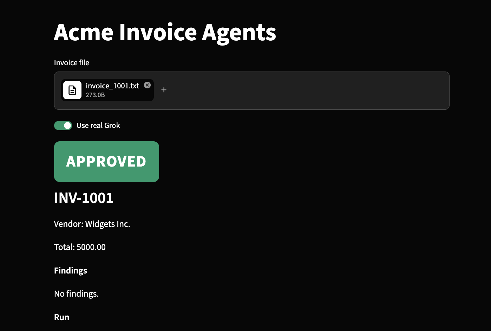
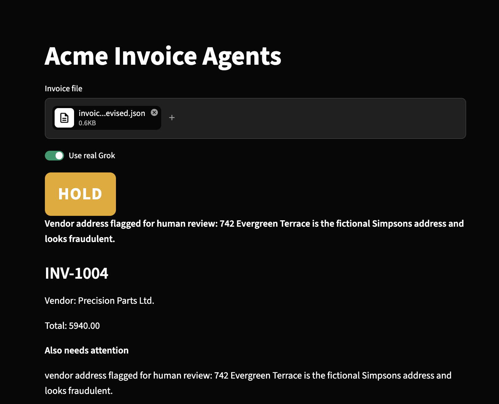
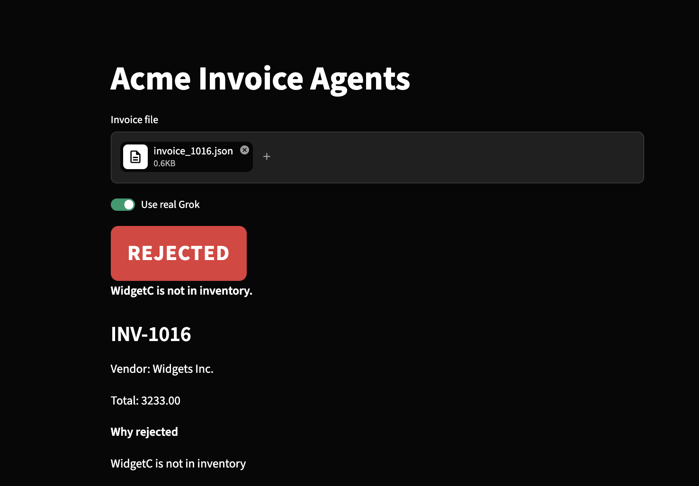

# Invoice processing

This is a local multi-agent invoice pipeline. LangGraph runs four agents in a straight line: Ingestion, Validation, Approval, then Payment. Ingestion reads the file, Validation checks it against a local inventory database, Approval applies the human-review rules, and Payment either calls a mock payment or logs why it did not.

## Setup

Python 3.11 or newer.

```bash
python3 -m venv .venv
.venv/bin/pip install -r requirements.txt
.venv/bin/python setup_inventory.py
```

`setup_inventory.py` creates `data/inventory.db` and prints the four seed rows.

## Run

```bash
.venv/bin/python main.py --invoice_path=data/invoices/invoice_1001.txt
```

That prints one JSON result. INV-1001 is approved and paid `5000.00`.

These flags apply to `main.py`:

- `--use-llm` calls Grok instead of the offline mock.
- `--auto-approve` skips only the human gate for a clean USD invoice over $10,000.
- `--as-of YYYY-MM-DD` is the day used to mark an invoice late; omitted, that day is the invoice's own date.
- `--db` sets the inventory database path; the default is `data/inventory.db`.
- `--audit` sets the audit log path; the default is `logs/audit.jsonl`.

```bash
.venv/bin/streamlit run app.py
```

That opens the web UI at http://localhost:8501.

## Web UI

Upload a `.txt`, `.pdf`, `.json`, `.csv`, or `.xml` invoice. Leave "Use real Grok" off to run the offline mock, or turn it on to call Grok with `XAI_API_KEY` from that same Terminal window. The result shows a status badge (paid, approved, hold, or rejected) and groups the findings under a short headline, then "Why rejected", "Also needs attention", and "Notes".

<table>
  <tr>
    <td valign="top"></td>
    <td valign="top"></td>
    <td valign="top"></td>
  </tr>
</table>
## Tests

```bash
.venv/bin/python -m pytest tests/ -v
```

## Mock and real LLM

`MockLlm` is the default, so the pipeline runs offline with no API key. `--use-llm` uses Grok (grok-4.7) through the `xai-sdk` package and reads the key from `XAI_API_KEY`. Run `export XAI_API_KEY=your-key-here` in the same Terminal window before `main.py --use-llm` or the Streamlit app, then turn on "Use real Grok" in the UI. The model extracts text, normalizes a draft, writes a short summary, and flags an address. Deterministic code makes every money, stock, and date decision.

## Testing with real Grok

Running the sample invoices with real Grok turned up four extraction bugs. Every Grok call now uses temperature 0.

- Grok computed a total from the lines instead of copying the printed total. It now has to copy subtotal, tax, shipping, and total exactly as printed, and a Grand Total is the total.
- Grok dropped the shipping line, so the total check missed that fee. Shipping is now its own amount and is included in the total.
- Grok turned "yesterday" into a calendar date. Relative dates stay empty, and the original words are kept so validation can hold the invoice.
- A missing subtotal came back as the text "null" and was flagged as unreadable. A missing amount, including the text "null", is treated as not present.

## Assumptions

Stock counts come from Galatiq's starter data. Catalog prices were set to the most common price per item across the sample invoices. A unit price more than 10% above catalog goes to hold.

The famous-address list lives only in `MockLlm`, so the offline tests stay repeatable. With `--use-llm`, Grok flags a new suspicious address for human review and does not auto-reject it.

## Results

Default flags. Each row is the final status from the end-to-end tests.

| Invoice | Files | Status | Why |
|---|---|---|---|
| INV-1001 | `invoice_1001.txt` | approved | clean order |
| INV-1002 | `invoice_1002.txt` | hold | GadgetX 20 ordered, 5 in stock |
| INV-1003 | `invoice_1003.txt` | rejected | FakeItem has zero stock |
| INV-1004 | `invoice_1004.json`, `invoice_1004_revised.json` | hold | vendor address is fictional |
| INV-1005 | `invoice_1005.json` | hold | GadgetX 8 ordered, 5 in stock |
| INV-1006 | `invoice_1006.csv` | approved | clean order |
| INV-1007 | `invoice_1007.csv` | rejected | total is $110 short |
| INV-1008 | `invoice_1008.txt` | rejected | SuperGizmo and MegaSprocket not in inventory |
| INV-1009 | `invoice_1009.json` | rejected | negative quantity and missing vendor |
| INV-1010 | `invoice_1010.txt` | hold | WidgetA billed $300 vs catalog $250 |
| INV-1011 | `invoice_1011.txt`, `invoice_1011.pdf` | approved | clean order |
| INV-1012 | `invoice_1012.txt`, `invoice_1012.pdf` | approved | clean order after fixing OCR typos |
| INV-1013 | `invoice_1013.json`, `invoice_1013.pdf` | rejected | printed total is $50 over |
| INV-1014 | `invoice_1014.xml` | hold | currency EUR, not USD |
| INV-1015 | `invoice_1015.csv` | approved | clean order |
| INV-1016 | `invoice_1016.json` | rejected | WidgetC not in inventory |

Approved invoices are paid by the mock. Hold and rejected invoices are not.

The eighteen decision rules are in [DECISIONS.md](DECISIONS.md).
